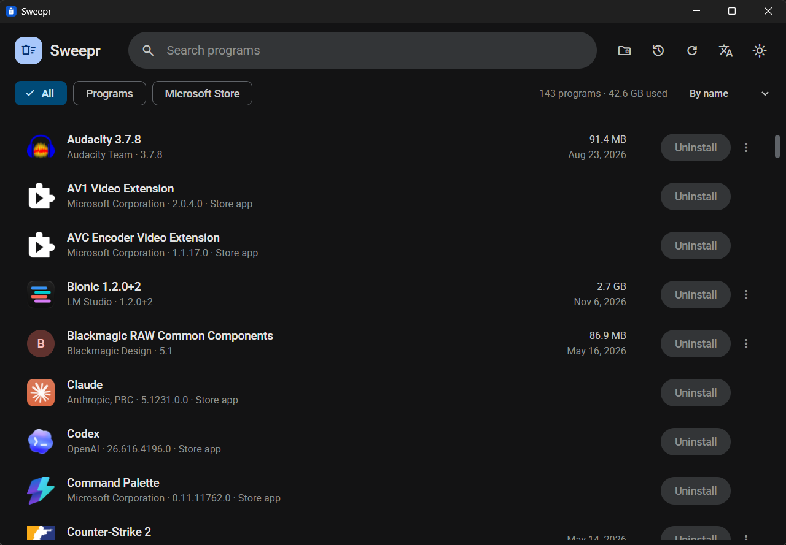
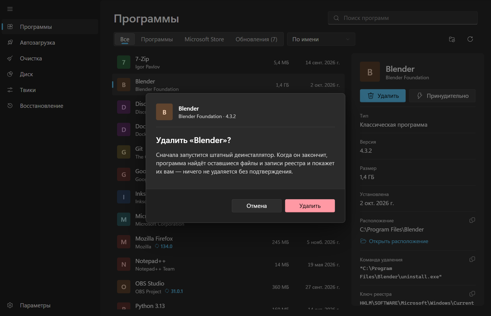
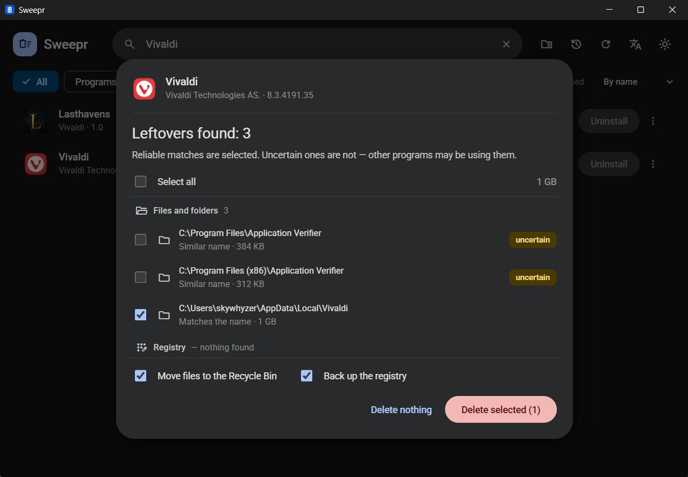
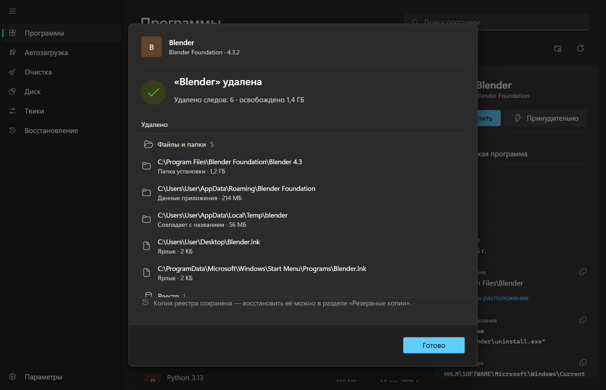
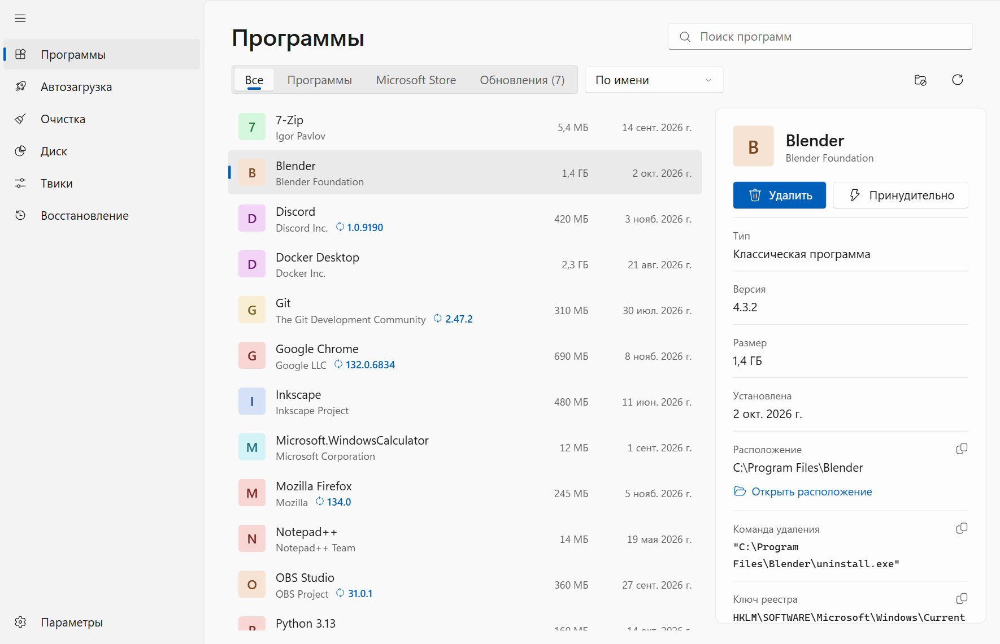

<div align="center">


# Sweepr

**Fast, modern uninstaller for Windows — removes programs *and* everything they leave behind.**

English · [Русский](README.ru.md)




</div>

## Features

- **One list for everything** — classic Win32 programs and Microsoft Store apps, with icons, publisher, version, size and install date.
- **Clean uninstall** — runs the program's own uninstaller first, then scans for leftover files, folders and registry entries.
- **Nothing is deleted blindly** — every leftover is shown with the reason it was found, and you confirm before anything is removed.
- **Force removal** — for broken or missing uninstallers: skips the uninstaller and removes all traces directly.
- **Registry backups** — a backup is made before registry cleanup, and you can restore it any time from the built-in backups manager.
- **Tweaks** — 40 reversible system tweaks across interface, privacy, gaming, updates and security: disable Windows Update, SmartScreen or UAC, remove shortcut arrows, turn on dark mode, block telemetry and location, stop promoted apps, and more. The previous value is saved before every change, high-risk tweaks ask for confirmation, and you can undo one or all of them in a click, even after a restart; Sweepr also notices when Windows reverts a tweak. (Microsoft Defender can't be toggled from the registry — Tamper Protection blocks it — so Sweepr says so instead of offering a switch that wouldn't work.)
- **Program updates** — when winget is installed, Sweepr shows which programs have a newer version and updates one or all of them.
- **Startup manager** — Run keys, the Startup folder, scheduled tasks that run at sign-in and third-party services in one list, with publisher and command line. Switching an item off deletes nothing (the same flags Task Manager uses; services move to manual start), and entries whose program is gone are flagged and can be removed with a backup.
- **Clean-up** — temporary files, Windows Update and Delivery Optimization caches, crash dumps, error reports, shader and browser caches, the Recycle Bin, with the size of each before anything is removed. Only things Windows and programs recreate are touched.
- **Leftovers of removed programs** — finds folders and registry keys of programs that are already gone (uninstalled badly or by another tool): nothing installed matches them and they haven't changed for 30 days. Every item is for you to review; folders go to the Recycle Bin, keys to a backup.
- **Recovery** — restore points (Sweepr creates one before uninstalling a program or applying a high-risk tweak), registry backups, and a repair kit: system file check (sfc), Windows image repair (DISM), network and Windows Update reset, DNS flush, icon cache rebuild, Explorer restart.
- **Disk usage analyzer (new in 0.2)** — a WinDirStat-style view: scan a drive or folder and see what takes up space as a sortable folder tree with share bars, a colored treemap (squarified, with cushion shading and zoom) and statistics by file type. Largest files list, open / show in Explorer, move to the Recycle Bin or delete permanently right from the view.
- **Explorer-style program list** — a details pane with version, size, install date, location, uninstall command and registry key (copy or open in Explorer); right-click menu; full keyboard control: arrows, type-ahead, `Enter` / `Delete` to uninstall, `Ctrl+F` / `F3` for search.
- **Instant search, filters and sorting** — by name, size or date.
- **Looks like Windows 11** — Fluent design with a Mica window backdrop, your Windows accent colour, Segoe UI and Fluent icons; light and dark themes.
- **English and Russian** interface.
- Small, native-feeling app powered by Tauri — no bundled browser.

## Screenshots

| 1. Confirm | 2. Leftovers found | 3. Done |
|---|---|---|
|  |  |  |

<p align="center"></p>

## Installation

Download the latest `Sweepr_x.y.z_x64-setup.exe` from the [Releases](https://github.com/skywhyzer/Sweepr/releases) page and run it.

> Some programs can only be removed with administrator rights. Run Sweepr as administrator if an uninstall fails with an access error.

## Build from source

Requirements: [Node.js](https://nodejs.org/) 20+, [Rust](https://rustup.rs/) and the
[Tauri prerequisites for Windows](https://tauri.app/start/prerequisites/).

```bash
git clone https://github.com/skywhyzer/Sweepr.git
cd Sweepr
npm install

npm run tauri dev     # run in development mode
npm run tauri build   # build the installer (src-tauri/target/release/bundle/nsis)
```

## Tech stack

- **Frontend:** React 19, TypeScript, Vite
- **Backend:** Rust, Tauri 2
- **Installer:** NSIS (English / Russian)

## Roadmap

Ideas for future versions are tracked in [Issues](https://github.com/skywhyzer/Sweepr/issues). Suggestions and pull requests are welcome.

## License

[MIT](LICENSE)
