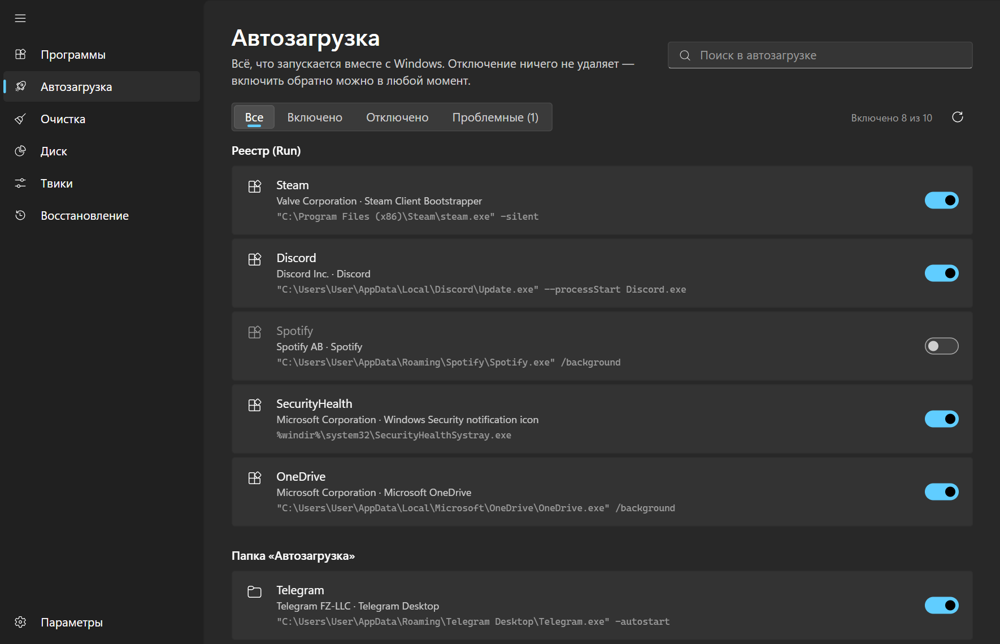
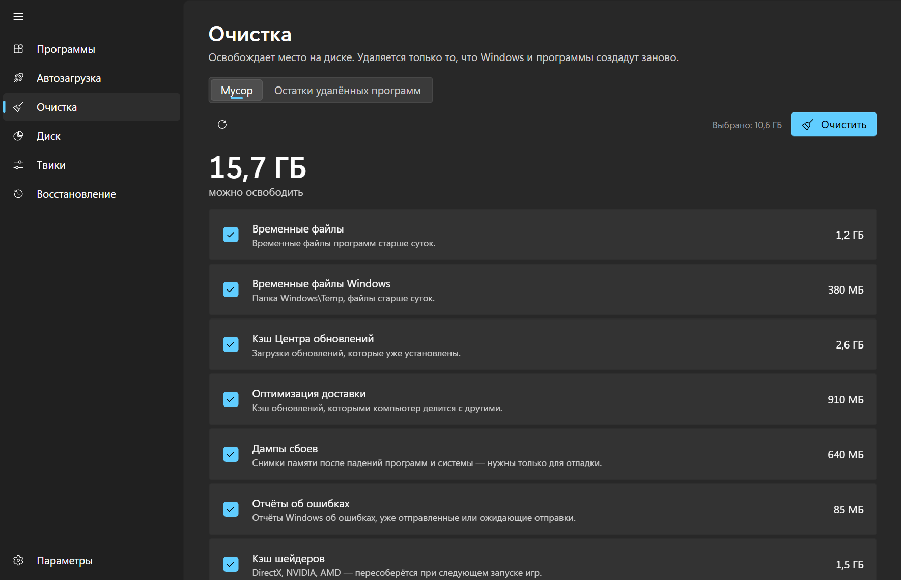
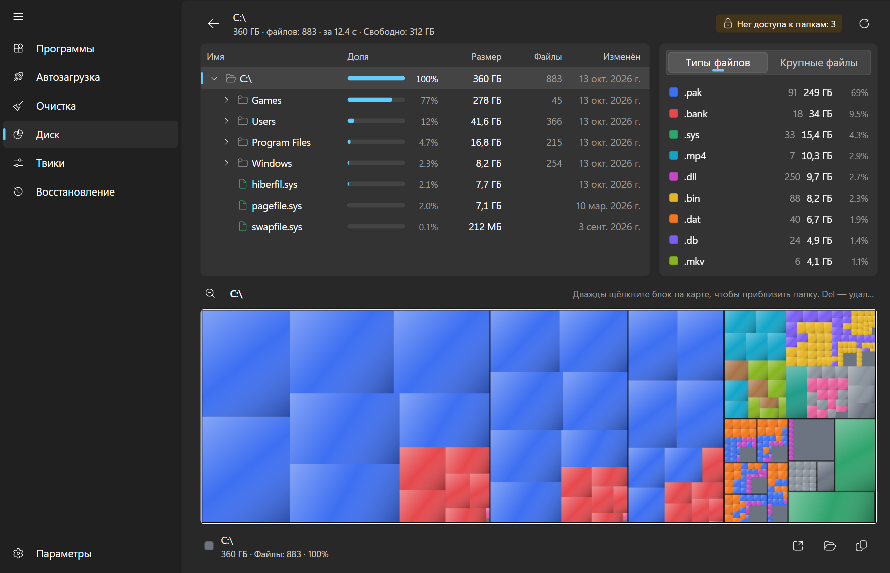
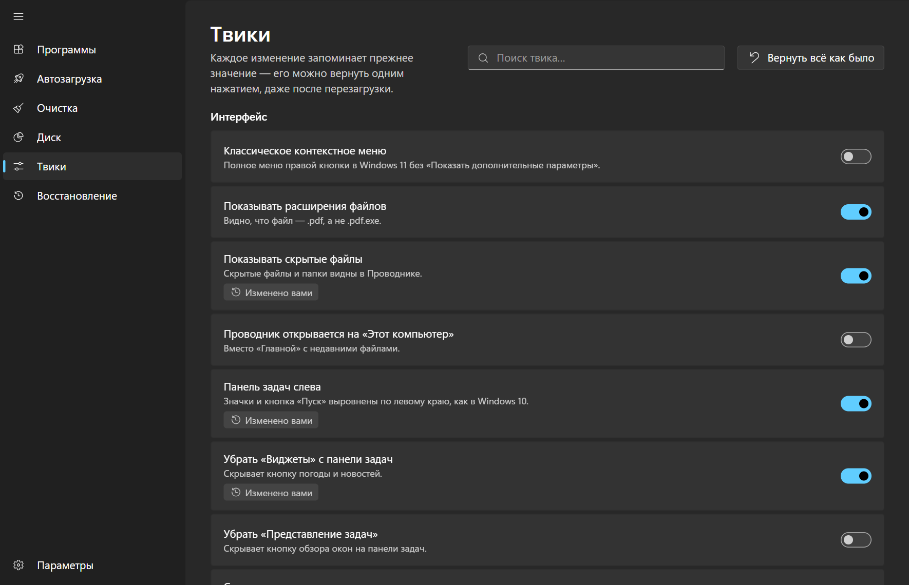
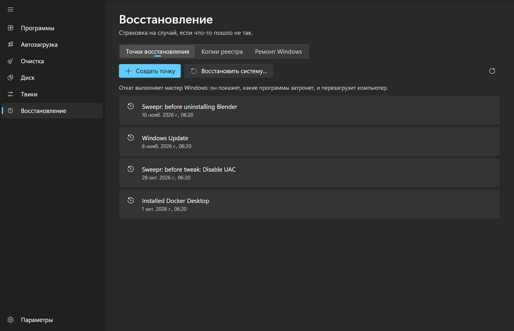

<div align="center">


# Sweepr

**Набор инструментов для Windows: удаляет программы вместе со всеми «хвостами», чистит систему, управляет автозагрузкой и помогает починить ПК, когда что-то пошло не так.**

[English](README.md) · Русский


</div>

## Что умеет Sweepr

Слева — панель навигации: **Программы · Автозагрузка · Очистка · Диск · Твики · Восстановление**, внизу — **Параметры**.

### Программы

- Один список для классических Win32-программ и приложений Microsoft Store: иконка, издатель, версия, размер, дата установки.
- **Чистое удаление.** Сначала запускается штатный деинсталлятор, затем Sweepr ищет оставшиеся файлы, папки и записи реестра. Каждый «хвост» показан с причиной, по которой он найден, и удаляется только после вашего подтверждения.
- **Принудительное удаление** — для сломанных или пропавших деинсталляторов: деинсталлятор пропускается, следы убираются напрямую.
- **Обновления через winget.** Если winget установлен, в списке видно, для каких программ вышла новая версия. Можно обновить одну программу или все сразу.
- **Как в Проводнике.** Панель деталей (версия, размер, расположение, команда удаления, ключ реестра), контекстное меню, управление с клавиатуры: стрелки, поиск по первым буквам, `Enter` / `Delete` — удалить, `Ctrl+F` / `F3` — поиск.
- Мгновенный поиск, фильтры и сортировка по имени, размеру и дате.

### Автозагрузка

- Всё, что запускается вместе с Windows, в одном списке: ключи Run, папка «Автозагрузка», задачи планировщика при входе и сторонние службы. Видны издатель и команда запуска.
- **Отключение ничего не удаляет.** Используются те же флаги, что у диспетчера задач, а службы переводятся на ручной запуск. Включить обратно можно в любой момент.
- Записи, у которых программа пропала с диска, помечаются и удаляются с резервной копией.

### Очистка

- **Мусорные файлы.** Десять категорий: временные файлы, кэш Центра обновлений и оптимизации доставки, дампы сбоев, отчёты об ошибках, кэш шейдеров, кэш браузеров, корзина и другие. Объём каждой категории виден до удаления. Затрагивается только то, что Windows и программы создают заново.
- **Остатки удалённых программ.** Папки и ключи реестра, которым не соответствует ни одна установленная программа, не связаны с автозагрузкой и службами и не менялись 30 дней. По умолчанию ничего не выбрано; папки уходят в корзину, ключи — в резервную копию реестра.

### Диск

Анализатор занятого места в духе WinDirStat: сканирует диск или папку и показывает дерево папок с долями, цветную карту-treemap (с приближением) и статистику по типам файлов. Список самых больших файлов, открыть или показать в Проводнике, отправить в корзину или удалить навсегда прямо оттуда.

### Твики

- 40 обратимых настроек в пяти группах: интерфейс, приватность, игры, обновления и безопасность.
- Среди них: отключение обновлений Windows, SmartScreen и UAC, удаление стрелок с ярлыков, тёмная тема, блокировка телеметрии и геолокации, запрет навязанных приложений.
- Перед каждым изменением запоминается прежнее значение. Любой твик (или все сразу) откатывается одним нажатием, даже после перезагрузки. Если Windows сама вернёт настройку, Sweepr это заметит.
- Твики с высоким риском выделены красным и просят подтверждение.
- Защитник Windows через реестр не выключить из-за Tamper Protection, поэтому Sweepr объясняет, как отключить его в «Безопасности Windows», а не показывает неработающий переключатель.

### Восстановление

- **Точки восстановления:** просмотр, создание, включение защиты системы, запуск мастера восстановления Windows. Sweepr сам создаёт точку перед удалением программы и перед рискованным твиком (включено по умолчанию, отключается в Параметрах; нужны права администратора).
- **Копии реестра.** Резервная копия создаётся перед каждой очисткой реестра, восстановить её можно в любой момент.
- **Ремонт:** проверка системных файлов (`sfc`), восстановление образа (`DISM`), очистка хранилища компонентов, сброс сети и Центра обновлений (папки переименовываются, а не удаляются), очистка DNS, пересборка кэша значков, перезапуск Проводника.

### Внешний вид

Выглядит как часть Windows 11: дизайн Fluent, фон Mica, системный акцентный цвет, шрифт Segoe UI Variable. Светлая и тёмная темы (или как в Windows), интерфейс на русском и английском. Приложение лёгкое, на Tauri, без встроенного браузера.

## Скриншоты

| | |
|---|---|
| <br/><sub>Автозагрузка</sub> | <br/><sub>Очистка</sub> |
| <br/><sub>Диск</sub> | <br/><sub>Твики</sub> |
| <br/><sub>Восстановление</sub> | <br/><sub>Светлая тема</sub> |

Удаление программы: подтверждение, найденные остатки, результат.

| 1 | 2 | 3 |
|---|---|---|
|  |  |  |

## Установка

Скачайте последний `Sweepr_x.y.z_x64-setup.exe` со страницы [Releases](https://github.com/skywhyzer/Sweepr/releases) и запустите его.

> Часть функций работает только с правами администратора: удаление некоторых программ, твики уровня системы, точки восстановления, ремонт. Если что-то завершается ошибкой доступа, запустите Sweepr от имени администратора.

## Сборка из исходников

Требуются [Node.js](https://nodejs.org/) 20+, [Rust](https://rustup.rs/) и
[зависимости Tauri для Windows](https://tauri.app/start/prerequisites/).

```bash
git clone https://github.com/skywhyzer/Sweepr.git
cd Sweepr
npm install

npm run tauri dev     # запуск в режиме разработки
npm run tauri build   # сборка установщика (src-tauri/target/release/bundle/nsis)
```

## Технологии

- **Интерфейс:** React 19, TypeScript, Vite
- **Ядро:** Rust, Tauri 2
- **Установщик:** NSIS (русский / английский)

## Планы

Идеи для будущих версий собираются в [Issues](https://github.com/skywhyzer/Sweepr/issues). Предложения и pull request’ы приветствуются.

## Лицензия

[MIT](LICENSE)
