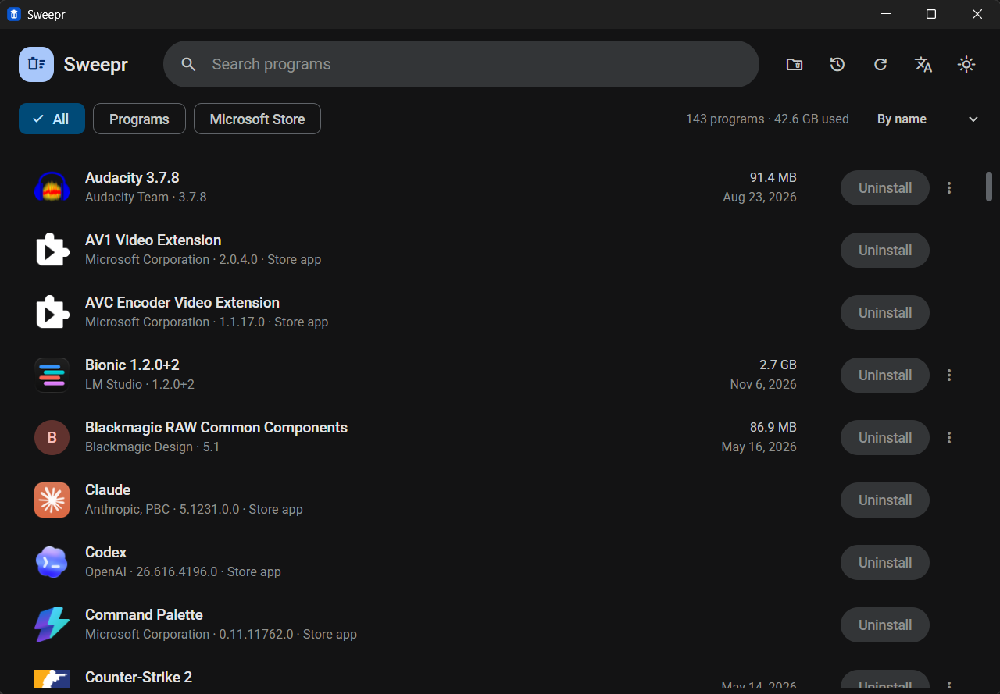
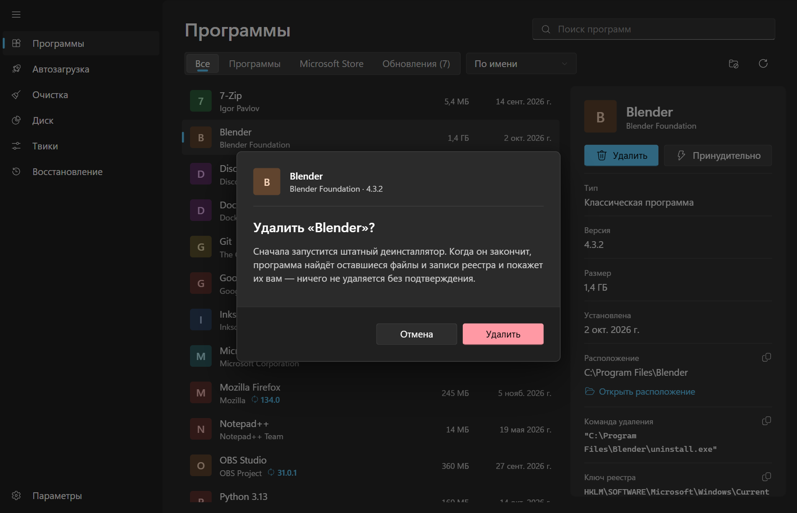
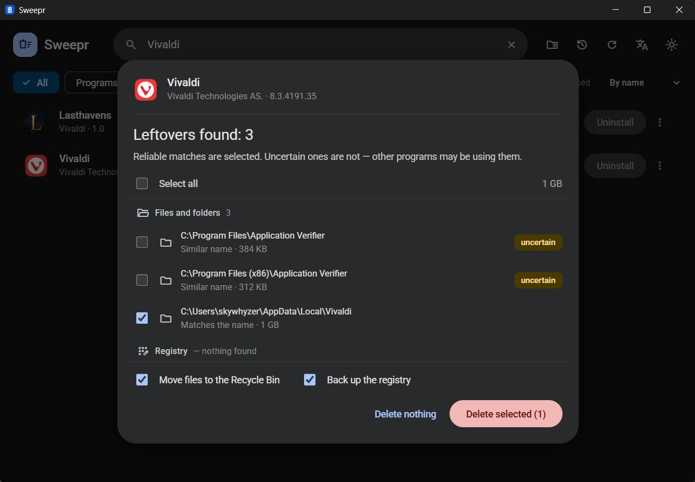
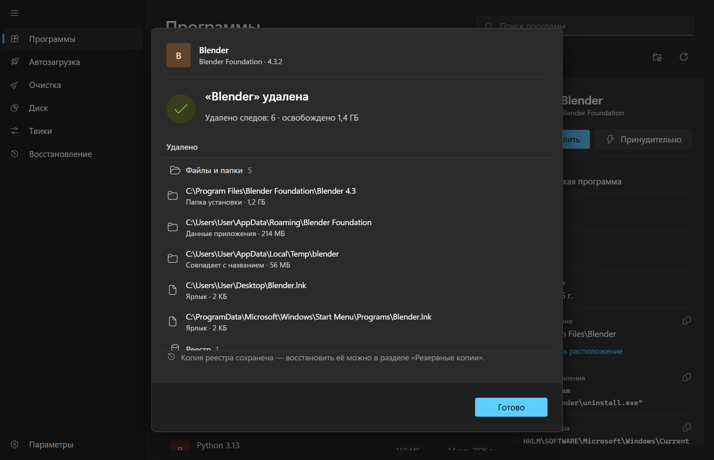
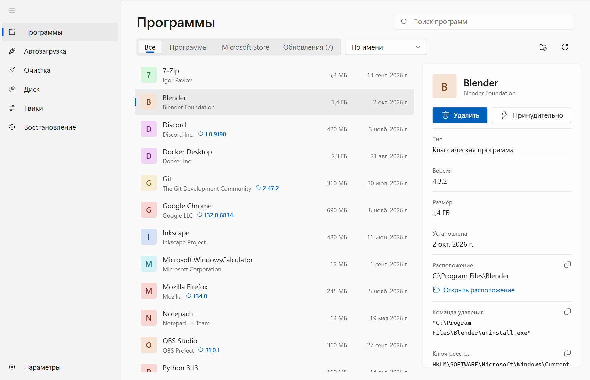

<div align="center">


# Sweepr

**Быстрый современный деинсталлятор для Windows — удаляет программы *и* всё, что они после себя оставляют.**

[English](README.md) · Русский




</div>

## Возможности

- **Единый список** — классические Win32-программы и приложения Microsoft Store с иконками, издателем, версией, размером и датой установки.
- **Чистое удаление** — сначала запускается штатный деинсталлятор программы, затем ищутся остаточные файлы, папки и записи реестра.
- **Ничего не удаляется вслепую** — каждый «хвост» показывается с причиной, по которой он найден, и удаляется только после вашего подтверждения.
- **Принудительное удаление** — для сломанных или отсутствующих деинсталляторов: пропускает деинсталлятор и убирает все следы напрямую.
- **Бэкапы реестра** — перед очисткой реестра создаётся резервная копия, которую можно восстановить в любой момент во встроенном менеджере бэкапов.
- **Анализ занятого места (новое в 0.2)** — режим в духе WinDirStat: сканирует диск или папку и показывает, что занимает место — дерево папок с долями, цветную карту-treemap (с объёмной заливкой и приближением) и статистику по типам файлов. Список крупнейших файлов, открыть / показать в проводнике, удалить в корзину или навсегда прямо оттуда.
- **Мгновенный поиск, фильтры и сортировка** — по имени, размеру или дате; `Ctrl+F` / `F3` переводит фокус в строку поиска.
- **Светлая и тёмная темы** в духе Material You.
- **Интерфейс на русском и английском.**
- Лёгкое приложение на Tauri — без встроенного браузера.

## Скриншоты

| 1. Подтверждение | 2. Найденные остатки | 3. Готово |
|---|---|---|
|  |  |  |

<p align="center"></p>

## Установка

Скачайте последний `Sweepr_x.y.z_x64-setup.exe` со страницы [Releases](https://github.com/skywhyzer/Sweepr/releases) и запустите его.

> Некоторые программы можно удалить только с правами администратора. Если удаление завершается ошибкой доступа, запустите Sweepr от имени администратора.

## Сборка из исходников

Требуются: [Node.js](https://nodejs.org/) 20+, [Rust](https://rustup.rs/) и
[зависимости Tauri для Windows](https://tauri.app/start/prerequisites/).

```bash
git clone https://github.com/skywhyzer/Sweepr.git
cd Sweepr
npm install

npm run tauri dev     # запуск в режиме разработки
npm run tauri build   # сборка установщика (src-tauri/target/release/bundle/nsis)
```

## Технологии

- **Интерфейс:** React 19, TypeScript, Vite
- **Ядро:** Rust, Tauri 2
- **Установщик:** NSIS (русский / английский)

## Планы

Идеи для будущих версий собираются в [Issues](https://github.com/skywhyzer/Sweepr/issues). Предложения и pull request’ы приветствуются.

## Лицензия

[MIT](LICENSE)
